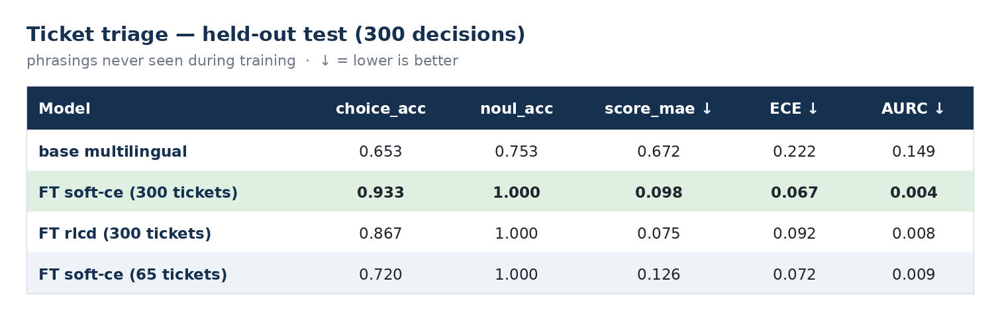

# Laya, from zero-shot to production: fine-tuning an open-source decision engine

### Routing support tickets in 5 languages in a single forward pass. From 33 to 300 examples, CPU then GPU — with the numbers, including the ones that hurt.

> **TL;DR** — I benchmarked and then fine-tuned **Laya**, a non-autoregressive decision engine, on a real use case (multilingual support-ticket routing). Zero-shot it looks promising but misses a critical signal *with high confidence*. After fine-tuning on 300 examples: **department choice 0.65 → 0.93**, **churn risk 0.60 → 1.00**, **urgency MAE 0.67 → 0.10** — and the test set only contains phrasings never seen during training.

---

## The problem: classify, don't generate

A support organisation receives tickets in English, French, German, Spanish, Hindi. Before any human touches them, you need to *classify*: which team, how urgent, is the customer about to churn, are they asking for a refund?

The reflex is to call a generative LLM: "answer in JSON: category, urgency, …". Except that:

- you **pay to generate text you immediately throw away**;
- the **JSON breaks** (markdown fences, missing fields) and you have to repair it;
- **latency swings** with output length;
- most of all, this isn't a generation task. It's a **discrete decision**.

## Laya in three lines

**Laya** (Convai Innovations, Apache-2.0) is a **"System 1" decision engine**: you give it a *state* (text, email, ticket or JSON) and **typed questions**, and it returns typed answers **with probabilities**, in **a single forward pass** (~18–33 ms on GPU), across 100+ languages.

Three primitives are enough:

| type | what it does |
|---|---|
| `choice` | pick one label out of N (with a description per option) |
| `score` | place the state on an ordered scale |
| `noul` | probability that the answer is *yes* |

It **never generates text**: nothing to parse, nothing to hallucinate. A built-in `Router` even picks the right checkpoint based on the detected language. And it all runs **locally**.

## My use case: a triage gateway

Each ticket becomes **four typed decisions**, in one pass:

| question | type | output | downstream use |
|---|---|---|---|
| `department` | `choice` | billing / technical / account | route to the right queue |
| `urgency` | `score` | 0 / 1 / 2 | prioritisation, SLA |
| `churn_risk` | `noul` | probability of "yes" | retention alert |
| `refund_requested` | `noul` | probability of "yes" | refund policy |

I built a small evaluation harness (metrics identical to Laya's own: accuracy, MAE, ECE, Brier, AURC, *selective accuracy*) plus a labelled dataset — first **33 hand-written tickets**, then larger versions.

---

## Step 1 — zero-shot: promising, with a blind spot

On the 33 tickets (5 languages):

- `choice` **0.909**, `noul` **0.879**, ECE **0.070**, AURC **0.032**
- but `churn_risk` **0.818** — and it's worse than that number suggests.

Reading the errors one by one, a pattern jumps out:

```
[fr] "Si elle n'est pas corrigée aujourd'hui, je résilie mon abonnement."
     churn_risk → 0.0033   (almost zero churn probability)   confidence = 1.00  ❌
[de] "Wenn das nicht sofort behoben wird, kündige ich meinen Vertrag."
     churn_risk → 0.0074                                     confidence = 0.99  ❌
[es] "Si no arreglan esto hoy, cancelo mi suscripción y me voy."
     churn_risk → 0.0518                                     confidence = 0.95  ❌
```

Tickets that explicitly threaten to leave are classified as "no churn", **with 99% confidence**. That is *exactly* the weakness the model card documents: `noul` can "follow its own labels", and negation is poorly handled.

> **Lesson #1**: a model can be great on average and **confidently wrong** on the one signal that matters. Read the errors, not just the aggregate.

---

## Step 2 — fine-tuning on 33 tickets? Not enough

I split 23 tickets for training and kept 10 aside, then fine-tuned on CPU (encoder frozen first, then full).

| run | choice | noul |
|---|---|---|
| before (base) | 0.800 | 0.800 |
| fine-tune, **frozen encoder** | 0.900 | 0.800 |
| fine-tune, **full** | 1.000 | 0.900 |

`churn` stays stuck around **0.60**. The reason: only **3 positive churn examples** in training. The problem isn't the settings, it's **the data**.

> **Lesson #2**: freezing the encoder isn't enough (the useful specialisation goes through the encoder) — and a class with 3 examples doesn't get learned.

---

## Step 3 — 100 tickets + GPU: the breakthrough

I move to **100 tickets** (the 33 hand-written ones + 67 generated, 5 languages) and train the **full model on GPU** (RTX 4070, CUDA `torch`).

Two settings change everything:
1. **`calib_frac=0.25`** makes the calibration slice big enough for the temperatures to **actually fit** (with 33 tickets they stayed pinned at 1.0);
2. more data for the class that was missing.

Results on the 21 held-out tickets (84 decisions):

| metric | base `multilingual` | after fine-tuning (100, GPU) |
|---|---|---|
| `choice_accuracy` | 0.714 | **0.905** |
| `noul_accuracy` | 0.833 | **0.952** |
| `score_mae ↓` | 0.823 | **0.333** |
| `ece ↓` | 0.134 | **0.100** |
| `aurc ↓` | 0.060 | **0.003** |
| `selective_accuracy@80` | 0.882 | **1.000** |

And above all: **`churn_risk` 0.714 → 1.000**. The blind spot from step 1 is fixed — not by swapping models, but by **giving it data**.

> **Lesson #3**: the "you need more data" conclusion holds. You go from "promising but not production-ready" to a usable triage.

---

## Step 4 — 300 tickets, and honest testing

This is where the difference between an *impressive* benchmark and a *useful* one lives.

If the test set is generated from the same templates as training, the model just learns the phrasing and the scores are inflated. So I split the dataset **by template**: one whole realisation per (language, department) is held out. The test set therefore only contains **phrasings never seen during training**.



| run | choice | noul | score_mae | ECE | AURC | sel@80 |
|---|---|---|---|---|---|---|
| base `multilingual` | 0.653 | 0.753 | 0.672 | 0.222 | 0.149 | 0.750 |
| **FT soft-ce (300)** | **0.933** | **1.000** | 0.098 | **0.067** | **0.004** | 0.989 |
| FT rlcd (300) | 0.867 | 1.000 | **0.075** | 0.092 | 0.008 | 0.994 |
| FT soft-ce (65 tickets) | 0.720 | 1.000 | 0.126 | 0.072 | 0.009 | 0.994 |

Per question (soft-ce 300 vs base):

| question | base | fine-tuned |
|---|---|---|
| `churn_risk` | 0.600 | **1.000** |
| `department` | 0.653 | **0.933** |
| `refund_requested` | 0.907 | **1.000** |
| `urgency` (MAE) | 0.672 | **0.098** |

What these numbers really say:

- **It generalises.** On **unseen phrasings**, fine-tuning lifts `choice` from 0.653 to **0.933** and drops `AURC` from 0.149 to **0.004**. That's not memorisation.
- **`soft-ce` vs `rlcd`**: `soft-ce` wins on the **categorical** decision and on **calibration** (ECE 0.067 vs 0.092); `rlcd` wins slightly on the **ordinal** one (urgency MAE 0.075 vs 0.098) and at high coverage. Nothing is decided in the abstract — measure on your own data.
- **Data curve**: at 65 tickets the binary flags (`churn`, `refund`) are **already at 1.000**. It's the **multi-class** decision (`department`) that needs volume (0.720 → 0.933 from 65 to 300 tickets).

> **Lesson #4**: binary decisions are learned fast; picking among several classes is not. Size your data per *primitive*, not on average.

### What about calibration?

It's the part people forget. A decision engine that says 0.95 and is wrong is *dangerous* if you use it to trigger an automated action. Hence the calibration metrics:

- **ECE** (confidence vs accuracy gap): 0.222 → **0.067**
- **AURC** (does confidence *rank* right from wrong?): 0.149 → **0.004**
- **`selective_accuracy@80`**: accepting only the most confident 80%, accuracy goes from 0.75 to **0.99**.

In other words: after fine-tuning you can **gate** on confidence and only auto-route what is actually safe.

> **Lesson #5**: calibration is a **deliverable**, not an implementation detail. Publish ECE alongside accuracy.

---

## My five takeaways

1. **Laya is a base, not a plug-and-play engine.** Zero-shot it nearly matches a hand-written rules engine — and the docs say it themselves: *"fine-tuning is where most of the value is"*.
2. **Full fine-tuning changes everything**; freezing the encoder does not.
3. **Data size scales with the primitive**: yes/no flags need little, multi-class choice needs volume.
4. **Test on unseen phrasings**, otherwise you're measuring memorisation.
5. **Calibration is the real story** if you want to automate: it's what makes a decision *gateable*.

## Bonus: a tiny UI to see it with your own eyes

Rather than trusting tables, I built myself a local web page: paste a ticket, hit **Analyze**, and you get **two columns side by side** — "without fine-tuning" vs "with fine-tuning" — with the full probability breakdown, the confidence, and a **"differs" badge** whenever the two models disagree. A collapsible guide documents every category (definition, domain of application, downstream action) and shows up as a hover tooltip.

It's the best way to catch the cases where the base model is **confident and wrong** (the `churn` blind spot from step 1) — and to confirm that fine-tuning actually fixes *that* case.

## Reproduce it

The full code is on GitHub: **[github.com/xuarig007/laya_test](https://github.com/xuarig007/laya_test)** — evaluation harness, datasets and tools:

```bash
# the evaluation harness (metrics identical to laya.evals)
python -m layabench run --data data/test300.jsonl --backend agent \
    --checkpoint checkpoints/t300-softce --device cuda --warmup

# compare two reports
python -m layabench compare results/after300_t300-softce.json \
    --baseline results/before300_multilingual_test.json

# fine-tune on GPU
python tools/train_laya.py --data data/train300.jsonl --eval data/test300.jsonl \
    --out checkpoints/t300-softce --base multilingual --device cuda \
    --epochs 12 --micro-batch 16 --grad-accum 1 --calib-frac 0.25 --loss soft-ce
```

## Conclusion

Laya isn't just another LLM: it's a **decision engine** — one forward pass, calibrated probabilities, zero generated text. Zero-shot it's a decent base; fine-tuned, on 300 examples and an hour of GPU, it's a multilingual triage that actually holds up.

If you have **classification / routing / gating** tasks in a multilingual stream, it's worth a look: faster, cheaper and more predictable than calling a generative model.

**Resources:**
- The model: [huggingface.co/convaiinnovations/laya](https://huggingface.co/convaiinnovations/laya)
- The docs: [nandhakishorm.github.io/laya](https://nandhakishorm.github.io/laya/)

*If this was useful, a clap 👏 helps others find it. And if you fine-tuned Laya on your own decisions, tell me how it went in the comments.*

---

*About the author — **CTO 3D/IA at Atos**. I build decision and applied-AI systems; the code for this article is open: [github.com/xuarig007/laya_test](https://github.com/xuarig007/laya_test).*

---

<!--
DRAFT — publishing notes (delete before publishing)

Medium tags (max 5): Machine Learning, NLP, Large Language Models, Python, Hugging Face
Estimated reading time: ~9 min
Cover image: blog/assets/cover-en.png
French version: blog/medium-laya-fr.md
-->


