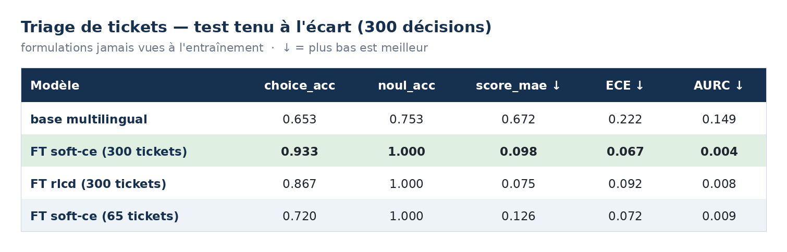

# Laya, du zero-shot à la production : affiner un moteur de décision open source

*Trier des tickets support en 5 langues, en un seul forward pass. De 33 à 300 exemples, du CPU au GPU — avec les chiffres, y compris ceux qui font mal.*

> **TL;DR** — J'ai évalué puis affiné **Laya**, un moteur de décision non-autorégressif, sur un cas d'usage réel (triage de tickets support multilingue). En zero-shot il est prometteur mais rate de façon *confiante* un signal critique. Après fine-tuning sur 300 exemples : **choix de département 0.65 → 0.93**, **risque de départ 0.60 → 1.00**, **erreur absolue d'urgence 0.67 → 0.10**. Et le test utilise des formulations jamais vues à l'entraînement.

---

## Le problème : classer, pas générer

Une organisation reçoit des tickets support en anglais, français, allemand, espagnol, hindi. Avant tout traitement humain, il faut *classer* : quelle équipe, quelle priorité, le client menace-t-il de partir, demande-t-il un remboursement ?

Le réflexe est d'appeler un LLM génératif : « réponds-moi en JSON : catégorie, urgence, … ». Sauf que :

- on **paie pour générer du texte qu'on jette** dès la ligne suivante ;
- le **JSON casse** (markdown, champs manquants) et il faut le réparer ;
- la **latence varie** avec la longueur de la sortie ;
- surtout, ce n'est pas une tâche de génération : c'est une **décision discrète**.

## Laya en trois lignes

**Laya** (Convai Innovations, licence Apache-2.0) est un **moteur de décision "System 1"** : on lui donne un *état* (texte, e-mail, ticket ou JSON) et des **questions typées**, et il renvoie des réponses typées **avec probabilités**, en **un seul forward pass** (~18–33 ms sur GPU), en 100+ langues.

Trois primitives suffisent :

| type | ce que ça fait |
|---|---|
| `choice` | choisir une étiquette parmi N (avec une description par option) |
| `score` | placer l'état sur une échelle ordonnée |
| `noul` | probabilité que la réponse soit *oui* |

Il **ne génère jamais de texte** : rien à parser, rien à halluciner. Un `Router` intégré choisit même le bon checkpoint selon la langue détectée. Et tout tourne **en local**.

## Mon cas d'usage : une passerelle de triage

Chaque ticket devient **quatre décisions typées**, en un seul passage :

| question | type | sortie | usage en aval |
|---|---|---|---|
| `department` | `choice` | billing / technical / account | router vers la bonne file |
| `urgency` | `score` | 0 / 1 / 2 | priorisation, SLA |
| `churn_risk` | `noul` | probabilité de « oui » | alerte rétention |
| `refund_requested` | `noul` | probabilité de « oui » | politique de remboursement |

J'ai construit un petit harness d'évaluation (métriques identiques à celles de Laya : justesse, MAE, ECE, Brier, AURC, *selective accuracy*) et un jeu de données étiqueté — d'abord **33 tickets écrits à la main**, puis des variantes plus grandes.

---

## Étape 1 — zero-shot : prometteur, mais un angle mort

Sur les 33 tickets (5 langues) :

- `choice` **0.909**, `noul` **0.879**, ECE **0.070**, AURC **0.032**
- mais `churn_risk` **0.818** — et c'est pire que le chiffre ne le dit.

En regardant les erreurs une par une, un motif saute aux yeux :

```
[fr] "Si elle n'est pas corrigée aujourd'hui, je résilie mon abonnement."
     churn_risk → 0.0033   (probabilité de départ quasi nulle)   confiance = 1.00  ❌
[de] "Wenn das nicht sofort behoben wird, kündige ich meinen Vertrag."
     churn_risk → 0.0074                                         confiance = 0.99  ❌
[es] "Si no arreglan esto hoy, cancelo mi suscripción y me voy."
     churn_risk → 0.0518                                         confiance = 0.95  ❌
```

Les tickets qui menacent explicitement de partir sont classés « pas de churn », **avec 99 % de confiance**. C'est *exactement* la faiblesse que la carte de modèle documente : le `noul` peut « suivre ses étiquettes » et la négation est mal gérée.

> **Leçon n°1** : un modèle peut être excellent en moyenne et **confiant à tort** sur le seul signal qui compte. Il faut lire les erreurs, pas seulement l'agrégat.

---

## Étape 2 — fine-tuner 33 tickets ? Pas suffisant

Je découpe 23 tickets pour l'entraînement, 10 tenus à l'écart, et j'affine sur CPU (encodeur gelé d'abord, puis complet).

| run | choice | noul |
|---|---|---|
| avant (base) | 0.800 | 0.800 |
| fine-tune **encodeur gelé** | 0.900 | 0.800 |
| fine-tune **complet** | 1.000 | 0.900 |

`churn` reste bloqué autour de **0.60**. En cause : seulement **3 exemples positifs** de churn dans l'entraînement. Le problème n'est pas le réglage, c'est **la donnée**.

---

## Étape 3 — 100 tickets + GPU : le déclic

Je passe à **100 tickets** (les 33 écrits à la main + 67 générés, 5 langues) et j'entraîne le **modèle complet sur GPU** (RTX 4070, `torch` CUDA).

Deux réglages changent tout :
1. **`calib_frac=0.25`** : la tranche de calibration devient assez grande pour que les températures **s'ajustent réellement** (avec 33 tickets, elles restaient bloquées à 1.0) ;
2. plus de données pour la classe qui manquait.

Résultats sur les 21 tickets tenus à l'écart (84 décisions) :

| métrique | base `multilingual` | après fine-tuning (100, GPU) |
|---|---|---|
| `choice_accuracy` | 0.714 | **0.905** |
| `noul_accuracy` | 0.833 | **0.952** |
| `score_mae ↓` | 0.823 | **0.333** |
| `ece ↓` | 0.134 | **0.100** |
| `aurc ↓` | 0.060 | **0.003** |
| `selective_accuracy@80` | 0.882 | **1.000** |

Et surtout : **`churn_risk` 0.714 → 1.000**. L'angle mort de l'étape 1 est réparé — non pas en changeant de modèle, mais en **donnant des données**.

> **Leçon n°3** : la conclusion du « il faut plus de données » se vérifie. On passe de « prometteur mais pas prêt » à un triage utilisable.

---

## Étape 4 — 300 tickets, et l'honnêteté du test

Là se joue la différence entre un benchmark *impressionnant* et un benchmark *utile*.

Si le jeu de test est généré par les mêmes templates que l'entraînement, le modèle apprend les tournures et les scores sont gonflés. J'ai donc découpé le jeu **par template** : on tient à l'écart **une formulation entière** par (langue, département). Le test n'utilise ainsi que des **phrases jamais vues à l'entraînement**.



| run | choice | noul | score_mae | ECE | AURC | sel@80 |
|---|---|---|---|---|---|---|
| base `multilingual` | 0.653 | 0.753 | 0.672 | 0.222 | 0.149 | 0.750 |
| **FT soft-ce (300)** | **0.933** | **1.000** | 0.098 | **0.067** | **0.004** | 0.989 |
| FT rlcd (300) | 0.867 | 1.000 | **0.075** | 0.092 | 0.008 | 0.994 |
| FT soft-ce (65 tickets) | 0.720 | 1.000 | 0.126 | 0.072 | 0.009 | 0.994 |

Par question (soft-ce 300 vs base) :

| question | base | fine-tuné |
|---|---|---|
| `churn_risk` | 0.600 | **1.000** |
| `department` | 0.653 | **0.933** |
| `refund_requested` | 0.907 | **1.000** |
| `urgency` (MAE) | 0.672 | **0.098** |

Ce que ces chiffres disent vraiment :

- **Ça généralise.** Sur des formulations **inédites**, le fine-tuning fait passer `choice` de 0.653 à **0.933** et l'`AURC` de 0.149 à **0.004**. Ce n'est pas de la mémorisation.
- **`soft-ce` vs `rlcd`** : `soft-ce` gagne sur le **catégoriel** et la **calibration** (ECE 0.067 vs 0.092) ; `rlcd` gagne légèrement sur l'**ordinal** (MAE d'urgence 0.075 vs 0.098) et le haut de couverture. Rien n'est tranché en absolu — mesurez sur vos données.
- **Courbe de données** : à 65 tickets, les flags binaires (`churn`, `refund`) sont **déjà à 1.000**. C'est la décision **multi-classe** (`department`) qui demande du volume (0.720 → 0.933 de 65 à 300 tickets).

> **Leçon n°4** : les décisions binaires s'apprennent vite ; le choix parmi plusieurs classes, non. Dimensionnez vos données en fonction de la *primitive*, pas en moyenne.

### Et la calibration ?

C'est le point qu'on oublie. Un moteur de décision qui annonce 0.95 et se trompe est *dangereux* si vous vous en servez pour déclencher une action automatique. D'où les métriques de calibration :

- **ECE** (écart confiance/justesse) : 0.222 → **0.067**
- **AURC** (la confiance *trie*-t-elle le vrai du faux ?) : 0.149 → **0.004**
- **`selective_accuracy@80`** : en n'acceptant que les 80 % les plus confiants, on passe de 0.75 à **0.99** de justesse.

Autrement dit : après fine-tuning, on peut **gater** sur la confiance et n'envoyer en automatique que ce qui est sûr.

> **Leçon n°5** : la calibration est un **livrable**, pas un détail d'implémentation. Publiez l'ECE avec l'accuracy.

---

## Ce que j'en retiens en 5 points

1. **Laya est une base, pas un moteur prêt à l'emploi.** Zero-shot, il égale presque une grille de règles écrite à la main — et la doc le dit : *« fine-tuning is where most of the value is »*.
2. **Le fine-tuning complet change tout** ; geler l'encodeur ne suffit pas.
3. **La quantité de données se dimensionne par primitive** : les oui/non s'apprennent avec peu, le choix multi-classe demande du volume.
4. **Testez sur des formulations inédites**, sinon vous mesurez la mémorisation.
5. **La calibration est le vrai sujet** si vous voulez automatiser : c'est elle qui rend la décision *gatable*.

## Bonus : une petite interface pour le voir de ses yeux

Plutôt que de croire des tableaux, je me suis fait une page web locale : on colle un ticket, on clique **Analyser**, et on obtient **les deux colonnes côte à côte** — « sans fine-tuning » vs « avec fine-tuning » — avec le détail des probabilités, la confiance, et un **badge « écart »** quand les deux modèles divergent. Un guide dépliable documente chaque catégorie (définition, domaine d'application, action en aval), accessible en infobulle au survol.

C'est le meilleur moyen d'attraper les cas où le modèle de base est **confiant et faux** (l'angle mort `churn` de l'étape 1) — et de vérifier que le fine-tuning corrige bien *ce* cas-là.

## Reproduire

Tout le code est sur GitHub : **[github.com/xuarig007/laya_test](https://github.com/xuarig007/laya_test)** — harness d'évaluation, datasets et outils :

```bash
# le harness d'évaluation (métriques identiques à laya.evals)
python -m layabench run --data data/test300.jsonl --backend agent \
    --checkpoint checkpoints/t300-softce --device cuda --warmup

# comparer deux rapports
python -m layabench compare results/after300_t300-softce.json \
    --baseline results/before300_multilingual_test.json

# fine-tuner sur GPU
python tools/train_laya.py --data data/train300.jsonl --eval data/test300.jsonl \
    --out checkpoints/t300-softce --base multilingual --device cuda \
    --epochs 12 --micro-batch 16 --grad-accum 1 --calib-frac 0.25 --loss soft-ce
```

## Conclusion

Laya n'est pas un LLM de plus : c'est un **moteur de décision** — un forward pass, des probabilités calibrées, zéro texte généré. En zero-shot c'est une bonne base ; en fine-tuné, sur 300 exemples et une heure de GPU, c'est un triage multilingue qui tient la route.

Si vous avez des tâches de **classification / routage / gating** dans un flux multilingue, ça vaut le détour : c'est plus rapide, moins cher et plus prévisible qu'un appel à un modèle génératif.

## Sources & inspirations

Ce projet s'appuie directement sur Laya et sur quelques idées connues. Voici ce dont il s'inspire.

**Le modèle et sa documentation**

- Carte de modèle — [huggingface.co/convaiinnovations/laya](https://huggingface.co/convaiinnovations/laya)
- Code et doc — [github.com/NandhaKishorM/laya](https://github.com/NandhaKishorM/laya) et
  [nandhakishorm.github.io/laya](https://nandhakishorm.github.io/laya/), en particulier `docs/evals.md`
  (format du jeu de données et définitions des métriques) et `docs/finetune.md` (la recette d'entraînement)
- Checkpoint multilingue — [convaiinnovations/laya-multilingual](https://huggingface.co/convaiinnovations/laya-multilingual) ;
  démo en ligne — [convaiinnovations/laya-demo](https://huggingface.co/spaces/convaiinnovations/laya-demo) ;
  PyPI — [pypi.org/project/laya](https://pypi.org/project/laya/)
- Article — M, N.; M, A., *From Laya to Vega: Open Non-Autoregressive Decision Models with Calibrated
  Probabilities*, Preprints 2026, 2026110781 ([doi:10.20944/preprints202611.0781.v1](https://doi.org/10.20944/preprints202611.0781.v1))
  — d'où viennent l'objectif RLCD et la posture « probabilités calibrées »

**Emprunté à Laya** : le format de jeu de données `laya-evals` et ses définitions de métriques
(réimplémentées ici en numpy), la recette de fine-tuning (soft-CE vs RLCD, ajustement des températures
sur une tranche de calibration tenue à l'écart) et le cadrage des « limites honnêtes » (checkpoints
sur-confiants, `noul` qui suit ses étiquettes, chute de précision au-delà de ~20 options).

**Littérature sur la calibration et l'évaluation** : Guo et al., *On Calibration of Modern Neural
Networks* (ICML 2017 — ECE et temperature scaling) ; Brier (1950) pour le score de Brier ; El-Yaniv &
Wiener (2010) et Geifman & El-Yaniv (2017) pour les courbes risque–couverture et la prédiction
sélective (AURC, selective accuracy) ; Kahneman, *Système 1 / Système 2* pour le cadrage.

**Jeux de données de référence des benchmarks de Laya** (inspiration, non utilisés ici) : MASSIVE,
XNLI, Banking77, SST-5, AG News — et TypeSafe/Jev comme comparateur tiers.

**Outillage** : PyTorch, Hugging Face `transformers`, uv, reportlab + Pillow, polices DejaVu.

*Si cet article vous a été utile, un clap 👏 aide à le faire lire. Et si vous avez affiné Laya sur vos propres décisions, racontez ce que ça a donné en commentaire.*

---

*À propos — **CTO 3D/IA chez Atos**. Je conçois des systèmes de décision et d'IA appliquée ; le code de cet article est ouvert : [github.com/xuarig007/laya_test](https://github.com/xuarig007/laya_test).*
